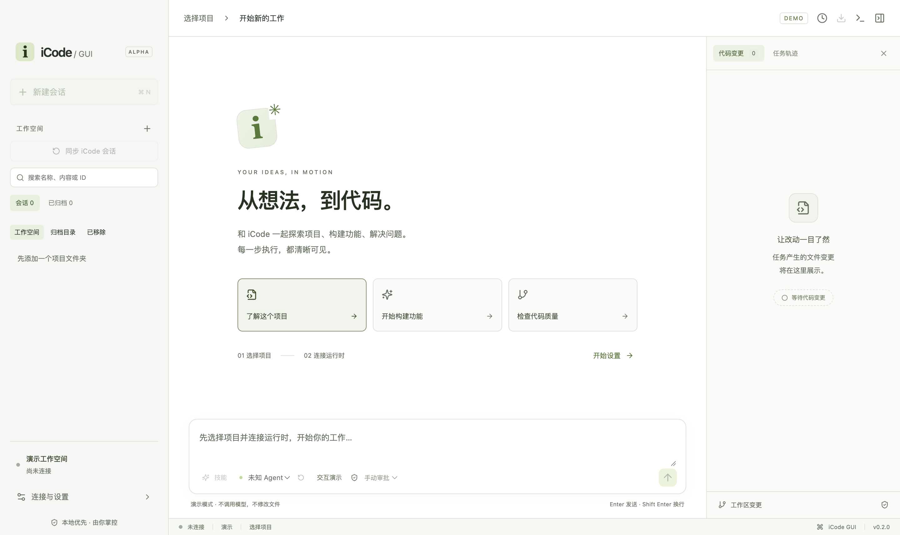
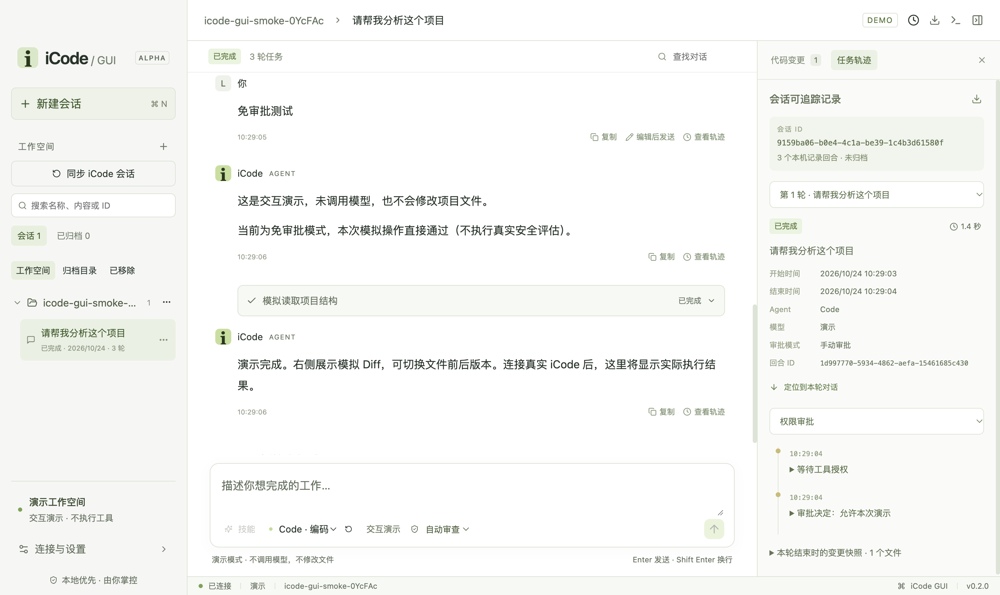

# iCode GUI

基于 Electron + React + TypeScript 的本地桌面编码助手，使用官方 ACP TypeScript SDK 连接 `icode acp`。当前是可运行的 Alpha MVP，不是完整 IDE。



## 启动

建议使用 Node.js 22.12+ 或 24 LTS 和 npm。

```bash
cd iCode-GUI
npm ci
npm run build
npm start
```

开发模式使用 `npm run dev`：Vite 提供界面热更新；修改主进程或 preload 后需重启开发命令。正式构建从本地文件加载，无需 Vite 服务。

若 Electron 的 GitHub 下载不可达，可在安装时指定镜像：

```bash
ELECTRON_MIRROR=https://npmmirror.com/mirrors/electron/ npm ci
```

PowerShell 使用 `$env:ELECTRON_MIRROR = 'https://npmmirror.com/mirrors/electron/'` 后执行 `npm ci`。依赖由 `package-lock.json` 固定；不要以跳过二进制下载作为常规安装方式。

## 体验流程

1. 打开“连接与设置”，选择项目文件夹。
2. 选择“交互演示”，进入工作空间。
3. 输入需求，查看流式输出和审批卡片。
4. 允许本次演示后，右侧出现模拟文件前后对比；也可在等待审批时停止任务。

**演示模式不调用模型、不执行真实工具、不修改项目文件。** 其中的消息和 Diff 都是固定演示数据，界面持续显示 DEMO 标识。

真实连接需要先安装上游 [iCode](https://github.com/openJiuwen-ai/iCode)，在 iCode 中配置可用模型，然后在本应用设置中切换“真实 iCode”，填写 `icode` 或可执行文件绝对路径。macOS 从桌面启动时 PATH 可能与终端不同，推荐填写绝对路径。该输入只接受程序路径，不接受 `uv run icode` 这样的复合命令。

程序使用参数数组启动（`--approval` 按所选模式传入，默认为 `manual`）：

```text
icode acp --agent Code --approval manual --workdir <绝对项目路径>
```

找不到程序、启动失败或协议异常都会报错，不会静默退回演示。

## 已实现

- 浅白色三栏布局、工作空间列表与切换、每个工作空间的展开/折叠（状态持久保存）。
- 会话新建、按名称/内容/ID 搜索、本机重命名、置顶、归档/恢复和确认删除；真实会话通过 iCode 删除成功后才移除本地记录。
- 可在连接设置中选择工具审批模式，也可在输入框下方按会话切换：手动审批（manual）、自动审查（auto）、免审批（bypass）；任务运行时禁用切换。自动审查必要时仍会请求授权。
- Markdown 消息、工具状态、停止、复制消息、编辑旧需求后发送、重新编辑上次需求、对话内容查找和回到最新消息。
- 每个会话独立保存草稿；阅读旧消息时不自动强制滚动到底部。
- 任务轨迹面板：会话/回合 ID、时间与状态、模型/审批模式、工具与审批/追问/取消/错误事件、事件筛选、定位对话、变更快照和完整会话 JSON 导出。
- 标准 ACP 双向通信、流式更新、工具审批及 iCode 批量追问回调。
- 会话列表/历史恢复接口、会话模型切换、运行日志和文本变更前后对比。
- 隔离的 preload 桥接、IPC 入参/来源检查、导航限制和 CSP。
- GUI 在 Electron userData 下的 `sessions-v1.json` 中保存本地显示缓存、演示会话、草稿、轨迹与工作空间信息；原子写入并在退出时刷新。真实模型上下文仍由 iCode 保存，GUI 不直接修改其底层存储。
- 重启后可离线浏览缓存；重新连接后才继续执行真实任务。未完成回合会标记为失败/中断，不重发任务，不恢复旧审批。
- 同工作区仅允许一个任务运行；连接切换前要求任务停止。

## 当前边界

- **未安装/运行真实 iCode，未进行实际模型或工具执行验证。** 当前已验证的是官方 SDK 与独立 stdio 假 Agent 的协议闭环，不能视为上游兼容性认证。版本记录见 `runtime/compatibility.json`。
- 已有工作空间列表和历史切换，但一次只连接一个项目/运行时；切换工作空间会断开原连接，多窗口项目并行尚未实现。
- 模型凭据需在上游配置，GUI 尚无模型创建/密钥管理表单。
- Diff 是文件修改前后版本切换，尚无逐行差异高亮、Monaco 编辑器和 Git staging；真实变更已经写入工作区，并非待应用补丁。
- 文件回滚、交互终端、worktree、工作流编辑器、附件和完整用量统计尚未实现。ACP 会话列表现已读取分页数据；列表搜索为本机显示缓存搜索，不是运行时全文搜索。
- 子进程异常退出后需要手动重新连接；不自动重发任务。最后一轮的本地显示缓存不等于运行时已保存的上下文。GUI 崩溃可能丢失约 250ms 内尚未写盘的最后更新。
- 时间线仅记录本客户端实际观察到的执行事件；从 iCode 重新加载的历史消息没有可靠的历史回合 ID/时间时不补造关联或历史时间戳。未观察到任务结束的回合不显示虚构耗时。
- 轨迹中的每轮变更快照是截至该轮结束时的会话累计 Diff；不是严格的该轮文件增量。
- 会话重命名、置顶和归档是本机元数据，不修改运行时标题；删除真实会话需要在线连接。演示和真实会话按工作空间/模式分开保存。
- 关闭时先关闭协议/管道，再尝试终止应用启动的进程组；工具自行脱离进程组的后台任务仍需真实运行时验证。进程隔离不是安全沙箱。
- 会话缓存和导出 JSON 包含对话、工具参数及结果等项目内容，按本地文件保存，未加密；导出前请检查内容。
- 日志做基础字段脱敏，但不能保证任意第三方程序的输出不含敏感信息，请在分享日志前检查。
- 当前实测平台为 macOS Apple Silicon；Windows/Linux 未验证，未生成签名安装包或自动更新功能。

## 验证

```bash
npm run check         # TypeScript
npm test              # 控制器与真实 stdio 协议测试，不调用模型
npm run build         # 生产构建
npm run test:desktop  # 启动 Electron，使用临时项目做桌面冒烟测试
```

桌面测试使用独立临时用户配置，自动验证项目选择、演示、审批、Diff、取消，以及会话增删改查、置顶、归档/恢复、工作区折叠、草稿、轨迹筛选、导出和重启恢复，不改写用户现有项目；截图保存到 `docs/screenshots/`。它需要可用的桌面会话环境。

2026-10-23 本机验证：12 项控制器/协议/存储测试通过；生产构建通过；桌面冒烟通过且无渲染进程异常；依赖更新后 npm audit 为 0 个已知漏洞（仅代表检查时结果）。

## 目录

```text
src/main/         Electron 启动、ACP 子进程、任务控制器
src/preload/      受限桥接
src/renderer/     React 界面和样式
src/shared/       IPC 合约和校验
scripts/          开发、构建和桌面验证
runtime/          运行时兼容性记录
tests/            控制器测试和独立协议 fixture
```

下一阶段优先：固定 iCode 提交和运行环境 → 实测模型配置、审批/追问、工具写入、停止和历史恢复 → 修复协议差异 → 再补齐设置与编辑器功能。详细设计见 [架构说明书](架构说明书.md)。

## 会话管理与追踪使用方式

- 左侧工作空间标题旁的箭头负责展开/折叠，点击项目名切换工作空间，顶部加号添加项目。
- 会话条目右侧 `…` 提供重命名、置顶、归档和删除；删除会再次确认，且不会回滚项目文件。
- 顶部会话搜索支持名称、已缓存消息内容或会话 ID；“已归档”筛选中可以恢复会话。
- 消息下方可复制内容、把旧需求放回输入框编辑；这些编辑动作不会修改已执行的历史，也不会自动重新执行。
- 右侧“任务轨迹”选择回合后可筛选工具/审批/交互/错误事件，展开查看详情；消息上的“查看轨迹”会选中对应回合。
- 顶部导出按钮会打开保存位置选择框，输出包含会话与轨迹的 JSON 文件。
- 快捷键：`⌘/Ctrl+N` 新建、`⌘/Ctrl+K` 会话搜索、`⌘/Ctrl+F` 对话查找；弹窗支持 Escape 关闭和 Tab 焦点循环。



## 在会话中使用 iCode Skill

连接真实 iCode 后，点击输入框下方的“技能”，查看当前会话 Agent 实际加载的技能。点击一项将“请使用 技能名 skill 完成以下任务：”加入草稿，补充需求后发送。也可直接输入该要求；iCode 根据技能目录调用 `load_skill`，随后按技能指引读取资源或运行脚本。选择技能本身不执行任务，也不绕过审批。

如果列表为空，先在 iCode 的 Code Agent 配置中启用技能/添加技能目录，再重新连接。GUI 目前不提供 iCode TUI 的斜杠命令解析，不应将 `/skill` 当作本应用的固定调用语法。

已用本机 iCode 0.31.0 验证技能列表与临时空会话删除，未调用模型。针对该版本新会话尚未落盘时删除接口返回 `Session not found` 的行为，GUI 会关闭活动会话后重试删除；只有目标 ID 精确匹配的不存在响应按幂等成功处理，其余错误保留记录并展示详情。

## 会话 Agent（编码 / 问答模式）

输入框下方原来的固定 Code 标签现为“会话 Agent”下拉框：

- **Code · 编码**：实现、修复、重构和调试代码。
- **QA · 问答**：iCode 内置的只读问答 Agent，用于阅读代码、解释架构和回答使用问题。实际工具行为取决于当前 Agent 配置；切换不撤销此前产生的文件修改。
- **自定义 Agent**：读取 iCode `profiles/agents/list`，显示可用于主会话的配置；点击旁边刷新按钮可更新列表。`subAgentOnly` 的 Explore、General 等不列入普通会话选项。

切换使用 `session/switch_agent`，保留当前会话与草稿，不会发送任务；运行中或已归档时禁止切换。切换后清除旧 Agent 的技能缓存，技能按钮会重新查询当前 Agent。任务轨迹保存每轮使用的 Agent 和切换历史，并随 JSON 导出。历史未记录的 Agent 显示“未记录”。离线可查看缓存，重新连接/选择会话会回读实际 Agent。

Agent 决定角色、指令和工具，审批模式决定工具授权方式，两者独立。当前已核查的内置主 Agent 为 Code 和 QA，没有额外虚构 Plan 模式。演示模式也可选择 Code / QA；演示 QA 不产生工具审批或模拟文件修改。旧运行时缺少 Agent 扩展时会显示提示，不伪造可用列表。

已在本机 iCode 0.31.0 临时工作区实测 Code → QA → Code 切换及状态回读，未调用模型。新增自动化覆盖子 Agent 过滤、自定义 Agent、切换失败、运行中拦截、会话切回、草稿与审批保留、轨迹持久化及桌面选择交互。

2026-10-24 Agent 模式验证：15 项自动化测试、生产构建及桌面端到端测试通过；真实 iCode 0.31.0 已验证模式切换，模型问答和工具执行未包含在本次实测范围内。

## v0.2.0：可见模式切换与跨工作空间同步

- 输入框上方直接展示 Code / QA 等可用主 Agent 按钮，下方仍保留 Agent 下拉框。
- 左侧“同步 iCode 会话”会连接真实 iCode，并从 iCode 最近工作空间及本地会话索引发现其他项目。索引只用于发现目录，真正的会话列表和消息仍通过 ACP 读取；不会直接写入 iCode 数据文件。
- 非当前工作空间展开后显示会话名称，点击会话会自动切换项目、连接并加载历史。与当前目录不同的 CLI 会话不再被隐藏。
- 重新打开应用时，如果上次使用真实 iCode，会自动连接和同步；不会自动发送任务。离线时也提供“连接 iCode，加载模式与会话”入口。
- ACP 进程从用户主目录启动，业务目录仍通过 `--workdir` 传入，避免部分项目启动目录导致 Python 初始化错误。默认命令 `icode` 优先解析本机 `~/.local/bin/icode`。
- 新增单实例保护及可见版本号，避免重复窗口同时写入同一份 GUI 历史。

已在本机发现 3 个已保存的 iCode 聊天会话，并从其他目录成功加载历史消息；本次未调用模型。自动化覆盖 17 项测试及桌面上的跨目录加载流程。

## 界面字号与模式选择

左下角“连接与设置”新增“界面字体大小”：12–20 px 可选，默认 13 px。选择后立即生效并自动保存，关闭设置或重启应用仍保留；“恢复默认字号”可重置。对话、侧栏、输入框和设置文字按比例调整，大字号下设置弹窗可滚动。

已移除输入框上方重复的 Code / QA 按钮和模式说明，保留下方 Agent 下拉框及刷新入口。

## 工作空间管理与技能搜索

工作空间标题右侧的 `…` 支持重命名显示名称、归档和移除。重命名不会重命名磁盘目录。归档保留会话与草稿，可在“归档目录”恢复；移除只从常用列表隐藏，文件、iCode 会话和本地缓存均保留，可在“已移除”中恢复。两种隐藏状态都会保存，下一次同步不会自动加回；手动选择同一项目目录会恢复显示。归档或移除当前工作空间时会断开空闲连接；运行中不允许操作。

技能弹窗新增搜索框，按技能名称及描述进行不区分大小写的筛选，支持清空、匹配数量与无结果提示。每次重新打开弹窗会清除上次搜索，选择技能仍只插入草稿，不自动执行。

本次构建、18 项自动化测试和桌面回归通过，包括工作空间重命名/归档/移除/恢复及技能搜索。
