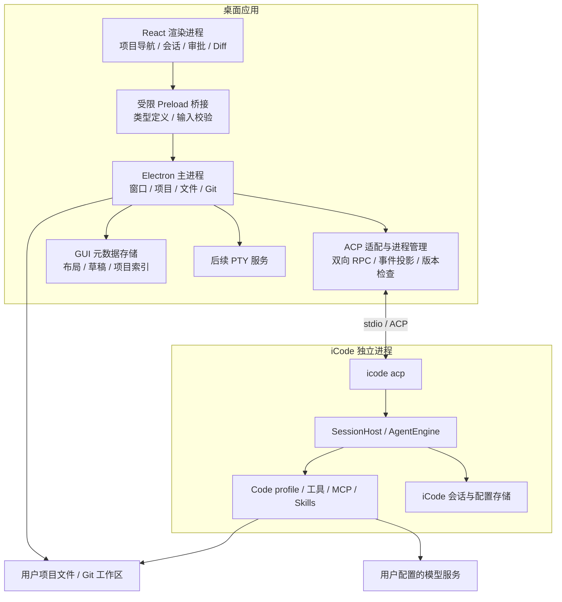
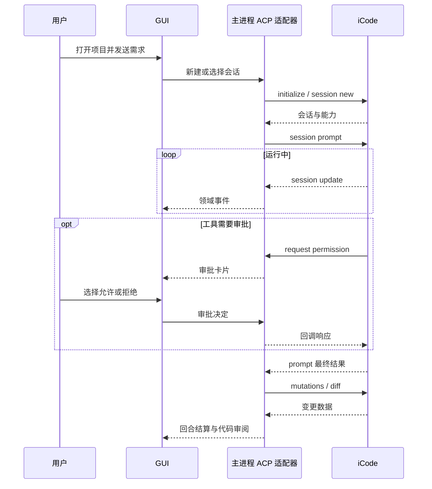

# iCode-GUI 架构说明书

版本：0.1｜调研日期：2026-10-23｜状态：架构建议，尚未运行集成验证

## 1. 结论与范围

建议将 iCode-GUI 建设为本地桌面编码助手：采用 Electron + React + TypeScript 构建界面，主进程通过 ACP（Agent Client Protocol）与独立的 iCode 进程通信，复用其 Code Agent、工具执行、上下文管理及会话能力。

第一版围绕“打开项目 → 发起任务 → 查看执行 → 处理审批 → 检查代码变更 → 继续会话”形成闭环。参考 Codex 的交互组织方式，不假定掌握 Codex 的内部架构，也不承诺一次复刻其所有功能。

**不建议从零重写 Agent，也不建议以解析 TUI 输出作为正式集成方案。** 当前 iCode 已有非 TUI 协议入口；项目的主要工作是桌面交互、协议适配、进程管理、状态恢复和代码审阅体验。

### 1.1 前提校验与信息分级

已按前提、独立判断、信息分类、来源、异议和盲区六项检查本方案：

| 检查 | 结果与处理 |
|---|---|
| 前提 | 用户称 CodeAgent，已核实 CLI 默认暴露名为 `Code` 的 Agent profile；不将其视作一个已确认稳定的独立 SDK 类。 |
| 独立判断 | GUI 可行；核心难点在任务状态和本机执行控制，不能仅按聊天页面估算。 |
| 信息分类 | 下文“已核实”来自公开文档/源码；“建议”是本项目设计；“待验证”必须通过原型确认。 |
| 来源 | 已阅读仓库首页、依赖、CLI/ACP 入口、ACP 服务端及前端接口文档；未成功完整克隆仓库，未安装或执行 iCode。 |
| 异议 | 不采用 headless `run` 作为交互主通道；它与 GUI 所需人工审批、追问的语义不符。 |
| 盲区 | 协议版本变化、Python 分发、并发写文件、审批等待、崩溃恢复、凭据、终端跨平台兼容均纳入设计。 |

架构调研时 `iCode-GUI` 是空目录。随后已启动桌面 MVP 开发，当前实现和验证范围见 `README.md`；下文仍描述目标架构，不代表全部功能已实现。默认假设为单用户、本地桌面、先单平台验证，再覆盖 Windows/macOS/Linux；远程执行、团队协作、云端任务调度和插件市场不在首版范围。

## 2. 上游能力与集成边界

### 2.1 已核实的基础

- `pyproject.toml` 当前公开内容标注版本 `0.31.0`，要求 Python ≥3.14；依赖包含 Textual 和 ACP SDK，Python 包名保留 `chrys`。[S2]
- CLI 区分 TUI、headless `run`、`acp` 和浏览器托管 TUI 的 `serve`；`serve` 不是本方案需要的新 GUI 服务端。[S3]
- ACP 启动入口可选 `Code` profile，并支持手动审批；stdout 为协议数据，stderr 为日志。[S4]
- 上游运行链路包括 `ChrysSessionHost`、`AgentEngine` 和内部 EventBus；其架构规则要求外部客户端使用 ACP，缺失能力应扩展协议而非导入私有实现。[S5][S6]

因此，本项目复用的是 **iCode 运行时和 Code 配置能力**，不是简单包裹一个 CLI 文本输入输出。

### 2.2 能力分工

| 能力 | 实现责任 | 首版处理 |
|---|---|---|
| 模型调用、工具循环、上下文压缩 | iCode | 复用，GUI 显示状态 |
| 会话执行和持久化 | iCode | GUI 不直接修改底层会话文件 |
| 会话列表、消息、取消 | ACP 客户端 | 首版实现 |
| 工具审批、用户追问 | iCode 发起、GUI 应答 | 首版必需 |
| 文件变更、Diff、回滚 | iCode 提供语义数据，GUI 渲染 | Diff 首版；文件回滚后续开放 |
| 项目导航、窗口、快捷键 | GUI | 自建 |
| 文件阅读、编辑器、Git 信息 | 桌面主进程服务 | 先阅读和 Diff，编辑后续加入 |
| 交互终端 | GUI + 独立 PTY 服务 | 第二阶段，区别于 Agent 工具日志 |
| 模型、Agent、Skills/MCP 管理 | 协议适配 + GUI 表单 | 首版最小模型配置，其他渐进开放 |
| 工作流可视化 | 待核实端到端协议覆盖 | 后续专题，不承诺现成支持 |

这些能力的接口清单见第 6 节。接口存在并不证明目标版本与桌面客户端已经兼容。

## 3. 技术路线选择

以下是设计判断，不是性能实测结论。

| 路线 | 收益 | 主要成本 | 建议 |
|---|---|---|---|
| Electron + React + ACP 子进程 | 前后端统一 TypeScript，适合编辑器、流式消息及进程管理 | Chromium 分发体积、依赖安全维护 | 首选 |
| Tauri + React + ACP 子进程 | 可控制桌面壳体积，系统权限模型明确 | Rust 桥接、WebView 差异、PTY 适配 | 团队具备 Rust 能力时可选 |
| 浏览器 UI + 本地 HTTP/WebSocket 服务 | 便于浏览器访问与未来远程化 | 服务发现、端口、认证、跨域及服务生命周期 | 远程需求明确后考虑 |
| 内嵌 TUI/终端 | 可快速演示现有功能 | 难实现结构化卡片、精确交互和统一状态 | 只用于验证工具可运行 |
| Python 内部 API 直连 | 深度定制方便 | 强耦合内部实现和事件模型，升级成本高 | 不作为默认路线 |

推荐组合：Electron、React、TypeScript、Vite；界面状态可选 Zustand；代码/Diff 可选 Monaco Editor；后续终端可选 xterm.js + node-pty。这些库是候选，实施时再核实版本、许可证、平台支持并锁定依赖，不在本说明书中虚构兼容版本号。

不额外引入 Python HTTP 中间层：ACP 已能直连，第一版新增一层服务只会扩大生命周期和故障面。

## 4. 总体架构



### 4.1 渲染进程

只承载界面和展示状态。可显示 Markdown、工具调用卡片、任务进展、权限请求、文件列表和 Diff。不得直接拥有 Node 文件系统、执行命令或读取凭据的通用能力。

消息区域使用虚拟列表；流式文本按小时间窗合并渲染。输入框支持文本、文件引用，图片仅在已确认模型能力时开放。计划列表来自运行时数据，不能仅根据助手自然语言猜测任务完成情况。

### 4.2 主进程与受限桥接

管理窗口、目录选择、文件读取、Git 查询、协议连接和本地索引。Preload 暴露诸如 `openProject`、`sendPrompt`、`cancelTurn`、`replyPermission`、`readWorkspaceFile` 的明确方法；不暴露任意命令执行或通用 IPC 转发。

IPC 每次请求都校验参数、窗口身份和项目边界。使用绝对规范路径，并处理符号链接、路径穿越、项目移动及 Windows 盘符大小写等问题。Git 查询以参数数组调用进程，避免把用户输入拼成 shell 命令。

### 4.3 ACP 适配层

把上游结构转成稳定的 GUI 领域事件，避免 React 组件依赖 `chrys/*` 细节。负责请求关联、通知分发、审批回调、错误归一、能力检查和恢复。

使用与锁定协议版本匹配的 ACP 客户端实现，遵循其帧格式和扩展编码；不把文档中的扩展名直接假定为裸 JSON-RPC 方法名，也不使用“一个 stdout 块就是一条完整消息”的解析方式。

主进程需持续读取 stdout 和 stderr。耗时的 `session/prompt` 等待期间，连接仍须处理服务端权限/追问请求和取消操作；串行阻塞整个 RPC 分发器会导致死锁。

### 4.4 iCode 进程管理

建议第一版每个已打开项目启动一个 ACP 子进程，项目内会话复用该连接；同一会话最多一个运行回合，不同会话可独立展示。首版同一文件工作区只允许一个写任务，其他排队，以减少多会话文件冲突。

示意启动命令（路径应由进程 API 分别传参）：

```text
icode acp --agent Code --approval manual --workdir /absolute/project/path
```

该命令参数来自已核实 CLI 入口，但目标安装包仍需实际运行验证。进程隔离只隔离故障与状态，**不构成文件或网络沙箱**。多个进程仍可能共享用户配置；GUI 设置写入应集中串行处理，避免误把“每项目进程”当成配置隔离。

退出时先取消任务、处理未决请求、关闭会话和管道；超时后终止进程树并记录异常退出。不要只杀直接子进程而遗留工具启动的后台程序。

## 5. 界面信息架构

```text
┌──────────────────┬──────────────────────────┬──────────────────────┐
│ 项目 / 会话       │ 当前任务与消息             │ 文件 / Diff / 详情    │
│                  │                          │                      │
│ 项目 A           │ 用户需求                   │ 变更文件列表          │
│   会话 1         │ 助手流式回答               │ before / after       │
│   会话 2         │ 工具执行卡片               │ 工具参数和结果         │
│ 项目 B           │ 待审批 / 待回答卡片         │                      │
│                  │                          │                      │
│ 设置 / 模型       │ 输入框 + 模型 + 停止按钮     │                      │
├──────────────────┴──────────────────────────┴──────────────────────┤
│ 可折叠输出面板：执行日志；后续加入交互终端                            │
└───────────────────────────────────────────────────────────────────┘
```

首版应具备：首次模型配置、项目选择、会话新建/恢复、实时消息、工具执行明细、审批与追问、停止、变更检查、明确错误提示。

模型选择和审批模式是会话操作；“设为后续会话默认值”是单独设置动作。不要让切换某个会话的模型静默修改全局默认配置。

默认情况下 Agent 工具可能直接修改工作区。右侧 Diff 是变更审阅，不等于“尚未应用的补丁”。若产品需要逐文件批准后才写入，必须另设计暂存工作区或工具写入策略，不能只添加“接受”按钮。

## 6. 协议与任务链路

### 6.1 接口映射

下表列出拟使用的 ACP 标准能力和 iCode 扩展语义名称，依据前端文档与服务端代码交叉检查。[S5][S7]

| GUI 行为 | 协议入口 | 实施约束 |
|---|---|---|
| 连接 | `initialize` | 保存协议/Agent 版本和能力信息 |
| 新建/恢复/列出 | `session/new`、`session/load`、`session/list` | 传绝对 cwd，列表分页 |
| 运行/停止/关闭 | `session/prompt`、`session/cancel`、`session/close` | 取消后等待结算状态 |
| 流式展示 | `session/update` | 分类型处理消息、工具、用量、计划 |
| 工具审批 | `session/request_permission` 回调 | 返回服务端提供的选项标识 |
| 用户追问 | `chrys/request_input` 扩展回调 | 按批次和原问题顺序提交答案 |
| 模型/审批模式 | ACP `set_session_model` / `set_session_mode` SDK 操作 | 序列化方法名由锁定 SDK 决定 |
| 项目变更审阅 | `session/mutations`、`session/diff` 扩展 | 支持缺少快照、冲突归属等提示 |
| 回滚 | `session/rollback` 扩展 | 后续开放；先预览、确认范围 |
| 模型配置 | `profiles/models/*` 扩展 | 读取时脱敏；不在 UI 缓存明文 |
| 运行时快照 | `chrys/session_runtime` 扩展 | 合并部分更新，避免清空已有状态 |

扩展均经过 SDK 的 `ext_method` / `ext_notification` 机制；详细字段和数据约束以固定版本代码及契约测试为准。首版无须实现完整 TUI 对等能力。

### 6.2 一次任务的时序



追问与审批使用不同请求类型，但都不能阻塞连接分发。后续流程是否继续，取决于真实后端结果，不能凭 UI 卡片关闭推定。

## 7. 状态、持久化与恢复

### 7.1 数据归属

| 数据 | 权威来源 | GUI 存储策略 |
|---|---|---|
| 模型对话、Agent 上下文 | iCode | 只保存可重建展示缓存 |
| 原始会话 ID、执行结果 | iCode | 建立项目到会话的索引 |
| 项目、固定会话、窗口布局、草稿 | GUI | 本地 SQLite，原型可用简单文件 |
| 工具权限状态 | iCode 当前请求 | GUI 临时保存关联信息，不持久重放批准 |
| 文件变化与回滚数据 | iCode mutation/snapshot | GUI 不另建竞争的回滚引擎 |
| 密钥 | 既有 iCode 凭据机制 | GUI 不建立第二套凭据真相 |

GUI 可持久保存 `Project`、`ConversationRef`、`Draft`、`Layout` 和脱敏 `DiagnosticRecord`。项目绑定规范路径；同一仓库的不同 worktree 是不同工作区，不能仅按仓库 URL 合并。

若未来引入系统 Keychain/凭据保险库，需要明确 iCode 如何解析密钥引用；目前不能假定其原生支持。本阶段优先通过官方模型配置接口写入，评估其本地存储保护措施。

### 7.2 状态机

```text
会话连接：disconnected → starting → ready → closing
                            ↘ failed → restarting
回合执行：idle → submitting → running → completed / failed / cancelled
                                   ↘ cancelling → cancelled / failed
运行中可附带：pendingPermissions[]、pendingQuestions[]
```

审批与追问使用集合，而非单一 `waiting` 布尔值，因为嵌套任务可能同时存在多个等待项。界面可显示“等待用户”，但底层仍按请求 ID 路由。

GUI 领域事件建议携带 `connectionGeneration`、`sessionId`、本地 `turnId`、`localSeq` 和事件载荷。它们是适配层添加的标识，不能宣称 ACP 自带可重放事件游标。

### 7.3 恢复原则

- 渲染进程刷新但主进程仍存活：重新订阅主进程当前快照与未决请求。
- ACP 子进程退出：标记当前执行中断、使旧连接请求失效、重启并加载会话；提示用户检查文件变化。
- 应用整体重启：从 iCode 的已保存会话恢复。最后一轮是否完整保存取决于上游行为，未验证前不承诺无损恢复。
- 不自动重发 `session/prompt`：工具可能已修改文件或调用外部系统，重放会造成重复副作用。网络/进程错误只能触发状态核对，不能等价为重试授权。
- 恢复历史时建立新的显示代次，避免历史重放与实时更新重复拼接。标准与扩展可能同时报告同一事实，适配层需指定优先通道，不能简单累加用量。

## 8. 文件、Diff、Git 与并发

Diff 优先使用运行时的 before/after 和 mutation 归属，而非拿 `git diff` 直接认定都是 Agent 改动。用户在运行前已有未提交修改、运行中手工编辑、外部格式化程序，都可能影响同一文件。

建议每轮结束后刷新变更摘要，用户打开文件时懒加载内容。二进制文件、大文件、缺少快照及无法可靠归属的变化显示限制说明，不伪造文本 Diff。

回滚分为“回退对话”和“同时恢复文件”，必须显示范围、排除项和当前文件冲突。未经验证不得宣称能恢复 Shell 命令造成的数据库、网络或项目外副作用；文件回滚不能等价为撤销整个任务。

后续并发方案可引入每任务独立 Git worktree，代价包括环境复制、依赖体积、非 Git 文件处理和合并冲突。第一版采用同工作区写任务串行，更容易验证正确性。

GUI 的本地编辑器保存也会与 Agent 写入竞争，故建议首版只读；开放编辑后再加入文件版本校验和冲突提示。

## 9. 执行权限与本机边界

- 启动使用 `manual` 审批；协议审批由 iCode 执行，GUI 负责展示完整工具、参数、目录和决定选项。不默认切到 bypass。
- 上游开发说明明确 headless `run` 会绕过审批并关闭用户交互，因此它仅适合受控批处理或测试，不适合主聊天链路。[S6]
- 渲染进程关闭 Node 集成并启用上下文隔离，使用受限 CSP；Markdown、链接、工具输出作为不可信数据处理，禁止任意 HTML/脚本执行和远程页面获得本机桥接。
- 工作目录边界校验保护 GUI 的文件服务，但不能限制任意 Shell/MCP 的所有副作用。更强隔离需要容器、系统沙箱或工具级执行策略，属于后续独立工程。
- 项目中的配置、hooks、MCP 和 Skills 可能执行程序，打开未知项目时需有项目信任机制；不将仓库文本当成 UI 的直接执行指令。
- 日志不记录密钥、授权头和默认完整提示内容；诊断导出由用户主动发起并脱敏。

## 10. 版本、分发与性能

### 10.1 版本与协议

当前调研使用公开 `main` 页面，各文件可能来自不同抓取时间；未拿到统一提交 SHA，不能作为精确可复现的运行基线。实施前必须取得一个固定提交或发行包校验值，记录到运行时清单，再跑契约测试。

已发现具体差异：前端文档称审批超时 `0` 表示无限等待；本次读到的服务端快照构造函数拒绝非正超时，CLI 又把配置值传入该构造函数。[S4][S5][S7] **因此不能照搬默认超时承诺，须在同一提交版本实际确认。**

ACP 的某些能力可能属于不稳定扩展；`initialize` 不一定逐项宣告所有私有扩展。适配器应维护“支持的 iCode 版本—扩展能力”矩阵，对缺失方法禁用相应界面，不能仅凭握手成功开放全部按钮。

### 10.2 分发

开发期先支持用户指定一个已安装的 `icode` 可执行文件，并在启动时检查版本、工作目录及模型配置。正式版再考虑随应用打包经过验证的 iCode/Python 运行时。

Python ≥3.14、原生依赖、ripgrep、PTY、平台架构和签名均影响安装成本。Electron 安装包不能自动解决 Python 依赖。必须分别验证目标 OS/CPU 的启动和工具执行；不建议用户首次启动时无提示下载不固定版本。

GUI 与运行时独立记录版本，整体升级前检查兼容性；任务运行时不热替换 runtime。保留升级前备份和可用版本，但数据格式降级是否可行必须单独验证。

上游标注 Apache-2.0 并包含第三方 NOTICE；发布时需保留适用的许可证、声明和第三方清单。[S1] 具体分发义务以发行所用版本的 LICENSE/NOTICE 为准。

### 10.3 性能目标（建议验收指标，非测量结果）

- 本地用户操作反馈目标 ≤100ms，流式 UI 合并刷新约 30–60ms；不将模型响应延迟计入桌面 UI 延迟。
- 长会话采用虚拟列表；限制单次渲染和日志保留量，Diff 按需加载。
- 不丢弃协议流中的关键事件；展示层可合并文本，队列积压时应监测并报告，而不是无限占用内存。
- 卡死时区分模型等待、工具运行、用户等待和进程失联；不能单凭“超过若干秒没文本”判断失败。

## 11. 建议代码目录

```text
iCode-GUI/
├── apps/desktop/
│   ├── main/                 # 窗口、启动、IPC 路由
│   ├── preload/              # 最小桥接 API
│   └── renderer/
│       └── features/         # projects/chat/approvals/diff/settings
├── packages/
│   ├── contracts/            # GUI 领域模型、IPC schema
│   ├── acp-adapter/          # ACP 标准 + iCode 扩展封装
│   ├── runtime-manager/      # 版本、进程、退出和恢复
│   ├── workspace-service/    # 路径、文件、Git
│   └── local-store/          # GUI 元数据及迁移
├── runtime/                  # 锁定版本清单、打包脚本；不直接堆源码
├── tests/
│   ├── contract/             # 固定版本 ACP 契约
│   ├── integration/          # 假 Agent 与真实 runtime
│   └── e2e/                  # 核心桌面流程
└── 架构说明书.md
```

上游源码建议独立管理，通过固定发行包、固定提交的依赖构建或小型 fork 取得；补丁只用于已证实的协议缺口。不要复制整个 Agent 到 GUI 后同时维护两套实现。

## 12. 分阶段落地与验收

工期以下列条件作估算：1 名熟悉 TypeScript 桌面开发的工程师、有可用模型账号、上游协议没有重大阻塞。它不是承诺；原型完成后再依据实测调整，跨平台签名、企业安全要求及上游修复另计。

| 阶段 | 估算 | 交付和退出条件 |
|---|---|---|
| P0 协议可行性原型 | 2–4 个工作日 | 固定版本；完成连接、新建、流式回复、审批、追问、停止、恢复和 Diff；证明无需 TUI 即可闭环 |
| P1 桌面 MVP | 7–12 个工作日 | 三栏 UI、项目与会话、模型配置、执行卡片、审批/追问、Diff、崩溃错误；在一个目标平台验收 |
| P2 工程化 | 5–10 个工作日 | 生命周期、状态恢复、长会话、日志脱敏、安装包与跨平台验证；逐平台确认支持矩阵 |
| P3 扩展 | 另行估算 | 编辑器、终端、回滚、worktree、Skills/MCP 管理、子任务视图；工作流接口另做审计 |

前三阶段合计约 14–26 个工作日；不包含完整 IDE、云端协作和 Codex 全功能复刻。若 P0 发现审批、恢复或差异接口存在版本缺口，应先修复/缩小范围，不能用终端输出解析掩盖问题。

### 12.1 必要验证

1. **传输与契约**：分包/合包、无效 JSON、stderr 大量输出、未知扩展、协议版本不兼容、长 prompt 期间反向请求。
2. **状态正确性**：重复发送、取消与完成竞态、等待审批时停止、迟到审批回复、窗口刷新、子进程突然退出。
3. **恢复与副作用**：重载历史不重复显示；断线不自动重发；检查已改文件与保存状态。
4. **文件安全**：已有未提交改动、外部编辑、二进制/大文件、路径越界和符号链接、跨会话冲突。
5. **配置与凭据**：缺少模型、错误 key、脱敏值读写语义、设置更新影响其他会话、日志和导出脱敏。
6. **平台与分发**：无开发环境的干净机器启动；进程树退出；Windows 路径/编码；后续 PTY 单独测试。

日常以可控假 Agent 验证协议与 UI，再以真实 iCode + 可用模型验证闭环。涉及模型实际工具执行的用例只在临时项目中运行。

### 12.2 立即可执行的第一步

建立无 GUI 的最小 TypeScript ACP 客户端，在临时 Git 项目中完成：“读取一个文件 → 请求修改 → 处理审批 → 查看 diff → 取消另一轮 → 重启恢复会话”。同时核实准确协议序列化、审批超时、模型配置与历史重放行为。通过后再搭建 Electron 页面，避免界面先完成而协议阻塞。

## 13. 来源与调研限制

以下均为上游一手资料；链接到 main 会随时间变化。

- [S1 仓库与 README](https://github.com/openJiuwen-ai/iCode)：定位、已有界面能力、安装与许可声明。
- [S2 pyproject.toml](https://github.com/openJiuwen-ai/iCode/blob/main/pyproject.toml)：版本、Python 与依赖。
- [S3 CLI dispatcher](https://github.com/openJiuwen-ai/iCode/blob/main/src/chrys/app/cli/app.py)：入口路由。
- [S4 ACP CLI](https://github.com/openJiuwen-ai/iCode/blob/main/src/chrys/app/cli/acp.py)：启动参数、日志、运行时初始化。
- [S5 ACP Frontend API](https://github.com/openJiuwen-ai/iCode/blob/main/src/chrys/app/acp/doc/frontend-api.md)：非 TUI 集成契约与扩展。
- [S6 上游架构与开发说明](https://github.com/openJiuwen-ai/iCode/blob/main/AGENTS.md)：分层、运行时与 headless 行为。
- [S7 ACP Server](https://github.com/openJiuwen-ai/iCode/blob/main/src/chrys/app/acp/server.py)：握手、会话、审批与扩展路由代码。

本次公开源码下载尝试因网络连接失败，研究基于可访问的在线源码页面。没有执行 runtime、没有测量性能、没有验证全平台安装、没有审计完整安全策略。上述待验证项已转成 P0 和验收任务，不应把本文视为实现完成或安全认证。


## 14. 当前实现补充：会话管理与可追踪性

已增加按工作空间与运行模式分区的本地版本化存储。GUI 保存显示缓存、草稿、别名、置顶、归档、变更快照与本机观察到的执行轨迹，真实运行时仍负责模型上下文。存储采用节流写入、临时文件后原子替换和退出刷新；损坏文件先备份，无法备份时停止覆盖。

会话删除调用既有 ACP 扩展，远端确认成功后再删除本地记录；别名/置顶/归档为本机功能。回合轨迹绑定本地稳定 ID，保存审批/工具/追问/取消/错误事件和实际观察时间。不将运行时重放的历史消息臆配到本地回合，不虚构 token 统计或历史耗时；每轮 Diff 快照明确标为会话累计变更。

该实现面向单机 Alpha 使用。大量会话与长历史场景下的数据库迁移、索引、磁盘配额、内容加密及长列表虚拟化仍属后续工程，不将 JSON 存储描述为最终规模化方案。
